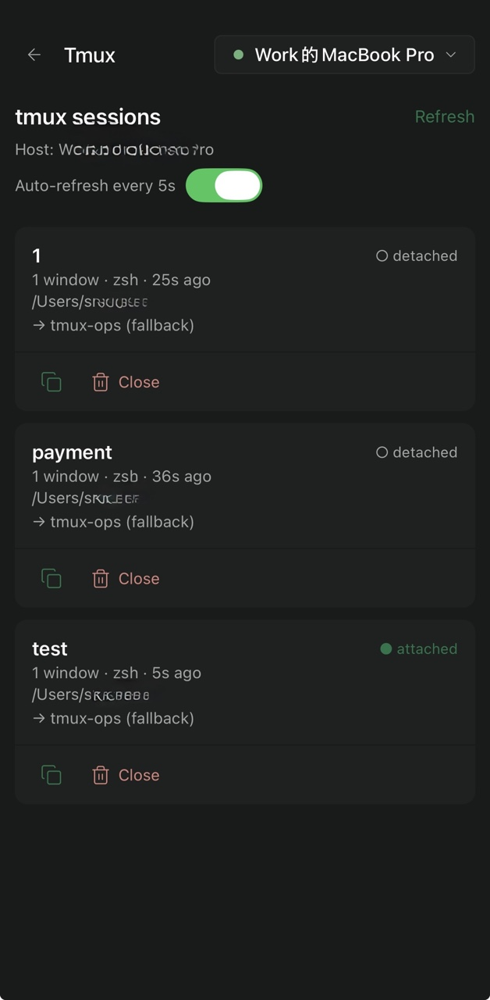
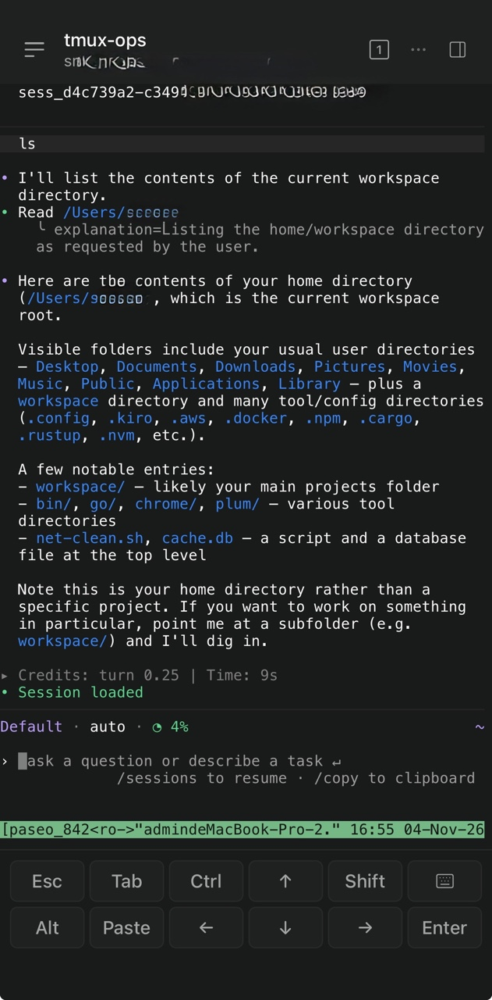

# paseo-tmux-manager

A Paseo plugin to list and attach to existing tmux sessions from any Paseo
client (desktop, web, mobile) — without starting new agent processes and without
killing the session when the client closes.

## What it does

- Adds a **Tmux** item to the sidebar that opens a screen listing the daemon
  host's tmux sessions (name, windows, attached state, age, active command,
  working directory).
- Each session shows its resolved **workspace binding**.
- The screen shows its Paseo host. To use two computers, install and enable the
  plugin on each computer; each host's Tmux screen lists that computer's tmux
  sessions. Session names may repeat across hosts without conflict.
- Tapping a session row opens a Paseo terminal on a temporary grouped tmux
  session. It shares the original session's windows but has separate mouse and
  key-table options, so local tmux controls are unchanged.
- Auto-refreshes the list every 5s by default. The switch on the list screen
  turns this on or off and saves the choice. Manual refresh remains available.
  Background refresh does not trigger the pull-to-refresh animation.
- The **Close** action in a session's bottom row asks for confirmation, then
  runs `tmux kill-session` for that exact session. It also closes any temporary
  Paseo grouped sessions attached to it. Processes in windows shared with a
  separate, non-Paseo tmux session can remain running; the action cannot be
  undone.

Closing the Paseo terminal removes only the temporary grouped session. The
original session and its processes survive.

## Scrolling a tmux terminal

Paseo's native phone terminal handles touch scrolling in its own terminal view.
That touch gesture does not send tmux a mouse wheel event, so dragging the phone
screen cannot reliably move through tmux's history. A plain shell can scroll
because its output stays in the terminal's local history; tmux keeps its own
history in copy mode. A native touch fix requires a Paseo app update.

The plugin provides keyboard navigation inside the **attached terminal**:

| Keys | Action |
| --- | --- |
| **Ctrl+↑** | Enter tmux copy mode and move up one page; then page up again. |
| **Ctrl+↓** | Page down while in copy mode. |
| **Ctrl+Shift+↑** | Enter copy mode if needed and jump to the oldest history. |
| **Ctrl+Shift+↓** | Jump to the bottom of history. |
| **q** | Leave copy mode and return to live output. |

On the phone, use the terminal's Ctrl and Shift modifier buttons with its arrow
buttons. On macOS, the physical-keyboard Ctrl+↑/↓ shortcuts may be intercepted
by Mission Control. The web terminal's mouse wheel uses tmux mouse mode on the
temporary grouped session. The original tmux session's mouse and root key-table
options are not changed. Copy mode belongs to the shared pane, so another
client viewing the same pane may see it while you scroll.

## External SSH clients

Each session has a copy icon in a separate action row. It copies a shell-quoted
`tmux attach-session -t 'name'` command to the clipboard of the device running
Paseo. Connect to the same host in Termius or another SSH client, then paste it.

## Workspace binding

For each session, its `#{session_path}` is matched, in order:

1. **exact** — equals a visible workspace's directory → use that workspace.
2. **project** — lives under a registered project's path → reuse a workspace in
   that project, or open one rooted at the session directory.
3. **fallback** — no match → a single catch-all `tmux-ops` workspace.

When a project matches multiple workspaces, the first visible one is chosen
(Phase 2 will add explicit selection).

## Architecture

```
shared/tmux.ts      RPC contracts (zod): tmux.list, tmux.attach
server/tmux.ts      run tmux via node:child_process (argv array, no shell), parse
server/binding.ts   pure resolver: session path -> workspace binding
server/handlers.ts  wire RPCs to the Paseo SDK (workspaces, terminals)
client/tmux-screen.tsx   the Tmux screen (React Native, theme-aware)
index.server.ts / index.client.tsx   registration entry points
```

## Develop

```bash
npm install
npm run typecheck
paseo plugin install /absolute/path/to/paseo-tmux-manager   # requires pluginsEnabled
paseo plugin logs paseo-tmux-manager
# after edits:
paseo plugin reload paseo-tmux-manager
```

## Roadmap

- P1: create/switch sessions, windows/panes, search, filter.
- P2: associate Kiro/Codex hook events with sessions.
- A single screen aggregating sessions from multiple hosts needs a cross-host
  plugin RPC API in the Paseo client SDK.

## Showcase

<p align="center">
  
</p>

<p align="center">
  
</p>
